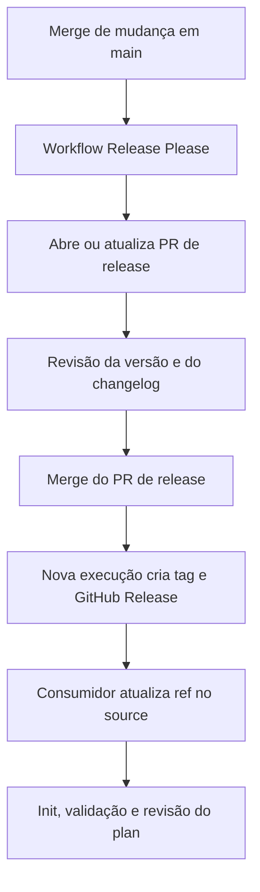

# Release Please para módulos Terraform

Este guia explica como preparar releases deste repositório e consumir seus módulos por uma versão explícita. O Release Please interpreta mensagens de commits, prepara um pull request (PR) de release e, após o merge, cria a tag e a GitHub Release. Ele não executa Terraform nem publica automaticamente módulos em um registry. [Funcionamento oficial](https://github.com/googleapis/release-please#whats-a-release-pr).

## Estado atual do repositório

O [workflow](../.github/workflows/release_please.yaml) executa em pushes para `main` e autentica com um token temporário de instalação do GitHub App. A action está fixada no SHA `45996ed1f6d02564a971a2fa1b5860e934307cf7` e consulta dois arquivos na raiz:

| Arquivo | Para que serve |
| --- | --- |
| [`.release-please-config.json`](../.release-please-config.json) | Define os módulos participantes e as regras de release |
| [`.release-please-manifest.json`](../.release-please-manifest.json) | Registra as versões; começa vazio e será atualizado pelo Release Please |

Estão cadastrados os 16 módulos com arquivos Terraform não vazios, com estratégia `terraform-module`, versões independentes e um PR de release agrupado. O componente corresponde ao nome do diretório; as tags seguem `<módulo>-v<versão>`, como `vpc-v0.1.0` e `security_group-v0.1.0`.

Os módulos participantes são `account_baseline`, `eks_access`, `eks_cluster`, `endpoint_gateway`, `endpoint_interface`, `load_balancer`, `load_balancer_listener`, `nat_gateway`, `permission_set`, `s3`, `security_group`, `security_group_egress_rule`, `security_group_ingress_rule`, `subnet`, `target_group` e `vpc`. Esse cadastro não atesta a prontidão funcional de cada módulo.

`modules/config` permanece fora porque seu único arquivo Terraform está vazio. Cadastre-o quando tiver implementação para publicar.

### O que fazer no dia a dia

Antes de começar, cadastre `RELEASE_APP_CLIENT_ID` em **Repository variables** e `RELEASE_APP_PRIVATE_KEY` em **Repository secrets**, conforme a seção de autenticação abaixo.

1. Faça uma mudança em um módulo cadastrado e use uma mensagem como `fix(vpc): corrigir composição das tags`.
2. Depois do merge em `main`, acompanhe a execução e revise o PR de release gerado.
3. Faça merge do PR de release quando quiser publicar as versões propostas.
4. No consumidor, use a tag publicada no `ref` do módulo e revise o plan da atualização.

O diretório dos arquivos alterados identifica o módulo afetado. O texto `(vpc)` ajuda a leitura, mas sozinho não seleciona o pacote. Para incluir outro módulo, acrescente seu caminho em `packages`, com um `component` único, seguindo o mesmo formato dos existentes.

A configuração local está preparada; a variável, a chave privada, as permissões da instalação e o primeiro ciclo com o App ainda precisam ser verificados no GitHub. As tags usadas neste guia são exemplos, sem confirmação de publicação.

## Como uma release funciona



O PR de release acumula mudanças até você decidir publicá-las. Fazer merge de uma funcionalidade e fazer merge do PR de release são etapas diferentes. As labels `autorelease: pending` e `autorelease: tagged` ajudam a acompanhar esse ciclo. [Ciclo do PR](https://github.com/googleapis/release-please#whats-a-release-pr).

Uma tag identifica um commit do repositório inteiro. Por exemplo, `vpc-v1.2.3` seleciona um snapshot completo, mas identifica a release de VPC. Subnet tem sua própria tag; não é necessário atualizar sua versão ao publicar somente VPC. Publicar outra tag não altera o `source` dos consumidores existentes.

## Preparação do workflow

### Exemplo para a estratégia atual

O workflow usa o modo manifest. O nome oculto `.release-please-config.json` é informado explicitamente porque difere do nome padrão da ferramenta:

```yaml
name: Release Please

on:
  push:
    branches:
      - main

permissions: {}

jobs:
  release-please:
    runs-on: ubuntu-latest
    steps:
      - name: Gerar token do GitHub App
        id: app-token
        uses: actions/create-github-app-token@64ab729a6294000f5aa4a4bc0b73d1f32bc45510 # v3
        with:
          client-id: ${{ vars.RELEASE_APP_CLIENT_ID }}
          private-key: ${{ secrets.RELEASE_APP_PRIVATE_KEY }}
          permission-contents: write
          permission-pull-requests: write
          permission-issues: write

      - name: Preparar releases
        uses: googleapis/release-please-action@45996ed1f6d02564a971a2fa1b5860e934307cf7
        with:
          config-file: .release-please-config.json
          manifest-file: .release-please-manifest.json
          token: ${{ steps.app-token.outputs.token }}
```

O workflow gera o token e o passa diretamente ao Release Please. As duas actions estão fixadas por SHA. Não é necessário checkout para essas etapas, que usam a API do GitHub. [Configuração do Release Please](https://github.com/googleapis/release-please-action#advanced-release-configuration).

### Autenticação com GitHub App

Use um GitHub App instalado na organização `igor-platform-lab`, com acesso ao repositório `terraform-modules`. Nas configurações do App, abra **Permissions & events → Repository permissions** e conceda **Read and write** a Contents, Pull requests e Issues. Depois de salvar, aprove as novas permissões na instalação, quando solicitado, e selecione o repositório. A tela da instalação deve deixar de exibir **No permissions** e **No repositories**. [Alterar permissões](https://docs.github.com/en/apps/maintaining-github-apps/modifying-a-github-app-registration#changing-the-permissions-of-a-github-app).

A visibilidade do App controla onde ele pode ser instalado: um App privado só pode ser instalado na conta que o possui. Isso é independente da visibilidade dos repositórios. Para manter o App privado na organização, registre-o nela ou transfira a propriedade. [Visibilidade dos Apps](https://docs.github.com/en/apps/creating-github-apps/registering-a-github-app/making-a-github-app-public-or-private).

No repositório, abra **Settings → Secrets and variables → Actions** e cadastre:

| Aba e tipo | Nome exato | Valor |
| --- | --- | --- |
| Variables → New repository variable | `RELEASE_APP_CLIENT_ID` | Client ID exibido em General do App |
| Secrets → New repository secret | `RELEASE_APP_PRIVATE_KEY` | Conteúdo completo da chave privada `.pem`, incluindo as linhas BEGIN e END |

Para obter a chave, use **Generate a private key** na área **Private keys** das configurações do App. O Client ID é um identificador; a chave privada é uma credencial e deve permanecer no secret. Não a coloque no YAML, em commits ou na documentação. [Gerenciar chaves privadas](https://docs.github.com/en/apps/creating-github-apps/authenticating-with-a-github-app/managing-private-keys-for-github-apps).

**Repository secret** atende a este workflow. **Environment secret** depende de um job vinculado ao ambiente; **Organization secret** permite compartilhar uma credencial com repositórios selecionados. Não é necessário criar os três. [Tipos de secrets](https://docs.github.com/en/actions/how-tos/write-workflows/choose-what-workflows-do/use-secrets).

A etapa `app-token` gera um token para o repositório atual, limitado às permissões solicitadas e concedidas à instalação. O token expira após uma hora e é revogado ao final do job por padrão. Ele é consumido por `steps.app-token.outputs.token` e não precisa ser salvo como secret. [Action de token](https://github.com/actions/create-github-app-token).

`permissions: {}` desabilita as permissões opcionais do `GITHUB_TOKEN` neste workflow. As permissões de escrita vêm do token do App; esse bloco não amplia nem substitui as permissões da instalação.

### Alternativa anterior com PAT

O workflow anterior usava `token: ${{ secrets.MY_RELEASE_PLEASE_TOKEN }}`. Esse nome correspondia a um **Repository secret** com um PAT autorizado para o repositório e escrita em Contents, Pull requests e Issues. O bloco `permissions` do workflow não concedia permissões adicionais ao PAT. Essa opção permanece como referência, mas não é usada pela configuração atual. [Credenciais do Release Please](https://github.com/googleapis/release-please-action#github-credentials).

PATs e tokens de instalação de Apps permitem disparar outros workflows conforme seus eventos e políticas. O `GITHUB_TOKEN` tem restrições próprias: atualmente, determinados eventos de PR podem gerar runs aguardando aprovação, enquanto push de tag feito com esse token não dispara outra run. Um merge feito por uma pessoa é um evento distinto. [Regras atuais de disparo](https://docs.github.com/en/actions/how-tos/write-workflows/choose-when-workflows-run/trigger-a-workflow).

### Arquivos de versão

Na configuração atual, cada módulo terá seu `CHANGELOG.md` e sua versão registrada no manifest. A estratégia `terraform-module` também procura arquivos existentes de README, `versions.tf` e metadados para atualizar os padrões de versão que reconhece; não cria uma variável genérica de versão no Terraform. [Implementação da estratégia](https://github.com/googleapis/release-please/blob/main/src/strategies/terraform-module.ts).

O manifest inicial contém `{}`: não declara versões previamente publicadas. Revise as versões e o histórico propostos no primeiro PR. Se já houver releases remotas, reconcilie-as antes de publicar a primeira release com esse manifest. [Inicialização](https://github.com/googleapis/release-please/blob/main/docs/manifest-releaser.md#bootstrapping).

Como alternativa, a estratégia `simple` usa `CHANGELOG.md` e `version.txt`; o atualizador de `version.txt` não cria esse arquivo automaticamente. Essa alternativa não está selecionada aqui. [Implementação de simple](https://github.com/googleapis/release-please/blob/main/src/strategies/simple.ts).

Para solicitar deliberadamente uma versão, o Release Please aceita o footer `Release-As: 1.0.0` no corpo de um commit. Esse recurso exige cuidado em um commit que afete vários pacotes; não é necessário para o fluxo normal. `1.0.0` não é uma versão definida para este projeto. [Controle da versão](https://github.com/googleapis/release-please#how-do-i-change-the-version-number).

## Mensagens de commit e compatibilidade

Use o formato `tipo(escopo): descrição`. O escopo identifica o módulo para leitura; `feat(vpc)` não configura versionamento independente de `vpc`. [Conventional Commits](https://www.conventionalcommits.org/en/v1.0.0/).

Os exemplos abaixo são hipotéticos e partem de `1.2.3`:

| Mudança | Exemplo | Próxima versão |
| --- | --- | --- |
| Correção compatível | `fix(vpc): corrigir composição das tags` | `1.2.4` |
| Melhoria de desempenho compatível | `perf(vpc): simplificar cálculo interno` | `1.2.4` |
| Funcionalidade compatível | `feat(vpc): adicionar configuração opcional de DNS` | `1.3.0` |
| Quebra de compatibilidade | `feat(vpc)!: renomear cidr_block para cidr` | `2.0.0` |
| Documentação ou manutenção sem quebra | `docs: explicar consumo por tag` | Normalmente não abre release sozinha |

Se houver várias mudanças, prevalece o maior incremento. Regras específicas para versões `0.x` podem ser configuradas; confira a versão calculada no PR. [Estratégia de incremento](https://github.com/googleapis/release-please/blob/main/src/versioning-strategies/default.ts).

Para explicar uma quebra, acrescente um footer:

```text
feat(vpc)!: renomear cidr_block para cidr

BREAKING CHANGE: substitua cidr_block por cidr em todos os callers.
```

Em módulos Terraform, avalie especialmente remoção de outputs, novos inputs obrigatórios sem default, mudanças de tipos e alterações que exijam migração de state. O Release Please não deduz esses impactos a partir do HCL: a classificação e as instruções de migração dependem do autor.

Ao usar **Squash and merge**, confira se a mensagem final do squash segue Conventional Commits e preserva os footers necessários. O título do PR pode servir de mensagem, mas o que chega ao histórico de `main` precisa estar correto. Com merge ou rebase, cuide também das mensagens dos commits preservados. [Orientação sobre squash](https://github.com/googleapis/release-please#linear-git-commit-history-use-squash-merge).

## Consumir um módulo por tag

Exemplo com os inputs existentes em [modules/vpc](../modules/vpc/):

```hcl
module "vpc" {
  source = "git::https://github.com/<owner>/<repo>.git//modules/vpc?ref=vpc-v1.2.3"

  cidr_block = "10.16.0.0/16"
  tags = {
    Environment = "dev"
  }
}
```

Substitua `<owner>`, `<repo>` e a tag pelos valores reais. O módulo VPC atual fixa `us-east-2` no recurso e requer `tags`; esse exemplo não altera seu contrato.

Na URL, `git::` seleciona Git, `//modules/vpc` escolhe a subpasta e `?ref=vpc-v1.2.3` seleciona a revisão. O argumento `version` do bloco `module` é destinado a fontes de registry; fontes Git usam `ref`. [Fontes e versões de módulos](https://developer.hashicorp.com/terraform/language/block/module).

Como referência para cadastrar outro módulo futuramente, mantenha o formato e troque a subpasta e o prefixo da tag, preenchendo os inputs reais:

```hcl
module "config" {
  source = "git::https://github.com/<owner>/<repo>.git//modules/config?ref=config-v1.2.3"

  # Acrescente os inputs conforme o contrato publicado nessa tag.
}
```

O arquivo local `modules/config/main.tf` está vazio nesta revisão. Esse segundo bloco exemplifica somente o endereço de consumo: Config não está cadastrado no manifest e não há implementação funcional de AWS Config nesse arquivo.

O runner de `terraform init` precisa de acesso Git ao repositório, inclusive quando privado. O token do App no workflow de release não é automaticamente disponibilizado ao consumidor; configure autenticação Git por HTTPS ou SSH no ambiente consumidor, sem inserir credenciais no `source`. [Autenticação das fontes Git](https://developer.hashicorp.com/terraform/language/block/module#github-repository).

### Atualizar o consumidor

1. Leia o changelog e as instruções de migração da nova release.
2. Troque o `ref` pelo novo tag em uma alteração revisável no repositório consumidor.
3. No root consumidor, com backend, variáveis e credenciais habituais configurados, execute:

```bash
terraform init
terraform validate
terraform plan
```

Após mudar o `source`, execute `init` para obter o módulo correspondente. `init -upgrade` também pode atualizar providers dentro das restrições existentes; não é necessário adotá-lo por padrão para uma simples troca de `ref`. [Comportamento do init](https://developer.hashicorp.com/terraform/cli/commands/init).

Revise especialmente substituições e exclusões no plan antes de seguir o processo de aplicação do consumidor. Para voltar a uma tag anterior, gere outro plan: reverter código não desfaz automaticamente alterações de infraestrutura ou de state.

Mantenha tags publicadas estáveis. Um `ref` apontando para `main` acompanha uma referência móvel; para maior precisão, Git também aceita um SHA de commit. [Revisões em fontes Git](https://developer.hashicorp.com/terraform/language/block/module).

## Versão conjunta ou independente por módulo

| Modelo | Exemplo de tag | Consequência |
| --- | --- | --- |
| `simple` na raiz, alternativa | `v1.2.3` | Todos os módulos compartilham a versão do repositório |
| Manifest com um pacote por diretório, modelo atual | `vpc-v1.2.3` | Cada pacote pode ter versão e changelog próprios |
| Um repositório por módulo | `v1.2.3` em cada repositório | Históricos e releases separados |

Versionar cada módulo exige uma configuração adicional; apenas mudar o escopo do commit não basta. No modo manifest deste repositório, `.release-please-config.json` declara os caminhos em `packages` e `.release-please-manifest.json` registra suas versões. A action passa a usar esses arquivos, sem o input `release-type` do exemplo simples. Componentes e prefixos de tags evitam colisões entre versões de módulos diferentes. [Manifest para monorepos](https://github.com/googleapis/release-please/blob/main/docs/manifest-releaser.md).

O modo manifest está configurado para os 16 módulos listados no início do guia. `separate-pull-requests: false` agrupa a revisão, mantendo versões distintas. O consumidor usa o prefixo correspondente, por exemplo `//modules/vpc?ref=vpc-v1.2.3`. A tag continua apontando para um commit do repositório inteiro.

## Diagnóstico e verificação

Use esta tabela ao acompanhar a primeira execução:

| Sintoma | O que verificar |
| --- | --- |
| Action não é resolvida | SHA informado e políticas de Actions do repositório |
| Arquivo de configuração não encontrado | O workflow deve apontar para `.release-please-config.json`, com o ponto inicial |
| Falha ao gerar token do App | Variável `RELEASE_APP_CLIENT_ID`, secret `RELEASE_APP_PRIVATE_KEY`, chave válida e instalação no repositório |
| Erro de acesso ou criação de PR | Permissões do App e aprovação das permissões na instalação |
| Instalação mostra No repositories | Configure Repository permissions no App e depois selecione os repositórios na instalação |
| Execução passa, mas não aparece PR de release | Commits elegíveis desde a última release e mensagem final em `main`; só `docs:` ou `chore:` geralmente não bastam |
| PR de release existe, mas não há tag | Merge desse PR e logs da execução seguinte em `main` |
| CI não roda automaticamente no PR do bot | Token utilizado, aprovação pendente e gatilhos do workflow de CI |
| `terraform init` não encontra o módulo | Tag publicada, caminho da subpasta e autenticação Git do consumidor |

A validação operacional estará concluída quando uma mudança elegível produzir um PR de release, seu merge gerar a tag/Release esperada e um consumidor conseguir inicializar o módulo por essa tag. Este guia foi conferido contra os arquivos locais e as referências oficiais em 28/10/2026; não foram executados workflows remotos, publicados releases ou aplicadas mudanças de infraestrutura.
